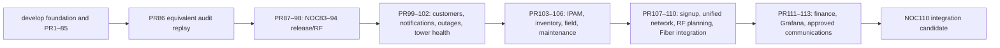

# NOC-110 integrated development candidate

## Scope and decision

This candidate consolidates NOC-83 through NOC-109 and their RF/foundation
dependencies in **treichhart1/nwo-noc only**. It is an isolated synthetic release
candidate, not production or live-pilot authorization. AI Fiber Designer remains
authoritative for engineering/as-built design; MikroTik Management stays separate.
No new feature domain, external transport, migration or device command is added.

No `AGENTS.md` or contributor instruction file exists in the inspected repository,
its tracked subdirectories, `/workspace`, or filesystem root. README, Makefile,
`scripts/validate.sh`, the CI workflow, NOC-93/94 release reports and module runbooks
were reviewed. Historical reports retain their original dated limitations; this
report and the final draft PR provide current consolidated evidence.

## Provenance and integration method

Audit date: 2026-11-16. Default branch `main` is
`5a5f21138339f522d7e6de6ad38b83f47d14f83c`; it is the merge base with the selected
baseline and **does not contain any of the 113 reviewed feature PR tips**. NOC-109
is `6e7f489f8f194324abaa406c07d74812c7345489`, 298 commits beyond that default.
Its push CI571 and PR CI572 passed all eight jobs. Every NOC-83–109 reviewed tip
has successful Actions evidence in the [pinned CI inventory](audits/NOC-110-upstream-ci.json).
A green feature branch does not promote its source to main.

[All 113 open draft PRs](audits/NOC-110-pr-snapshot.json) record exact base/head
branches and SHAs. **112 tips are direct ancestors** of NOC-109. PR86 is the sole
exception: audit commit `34e54e226f93159adf7d2dc52548d36aad277b46` was replayed as
`ad61cde731a7707af44734a7261474af3409671e` on corrected RF81 ancestry. Stable patch
IDs match; read-only `git merge-tree --write-tree` with NOC-109 yields the unchanged
NOC-109 tree. Its older branch must not be blindly merged or cherry-picked again.
One local remote-tracking ref for PR98 was absent; its exact GitHub tip and local
commit object were checked directly. This is a cache omission, not missing source.

Therefore `feature/noc-110-full-integration` branches directly from the complete
NOC-109 tip. No synthetic merge, squash, branch rewrite, PR retarget or duplicate
commit is required. The integration PR targets the unchanged NOC-109 branch, so
reviewers see only consolidation fixes/tests. Existing PRs remain open/draft.

The [full graph](audits/NOC-110-dependency-graph.mmd) includes every reviewed PR.
The compact milestone relationship is:



Future separately authorized integration order is the pinned develop foundation,
PR1→85, explicit reconciliation of PR86's already-present audit, then PR87→113→this
PR. Recheck actual tips and rerun CI as the train advances. Do not squash/rebase
the stack or treat this document as permission to merge it.

Reproduce the read-only manifest from a full-history checkout:

```bash
python scripts/release/integration_manifest.py --candidate HEAD > /tmp/noc110-manifest.json
```

It fails on missing ancestry, a changed replay, disconnected/duplicate migration
revisions or an unexpected schema head. It reports per-PR merge bases, default-branch
inclusion, ordered migrations and configuration names/types, without reading secret
values, connecting externally, moving refs or merging branches. The checked-in
[baseline manifest](audits/NOC-110-integration-manifest.json) describes the immutable
NOC-109 baseline; regenerate for the final integration SHA recorded in the draft PR.

## Shared backend and model review

Private routes use existing `current_user`, native domain role checks, `get_db`,
transactional mutations and `AuditLog`. Duplicate method/path contracts and version
consistency remain regression gates. SQLAlchemy's one registered metadata graph is
loaded from `app.models.entities`; new consolidation tests reuse existing fixtures
and services rather than introducing model copies or substitute engines.

| Identity | Canonical owner / integration behavior |
| --- | --- |
| Towers/POPs, devices, sectors, backhauls | Existing Site, Device, Sector, NetworkLink; domain FKs reuse their IDs |
| Physical equipment | NOC100 Asset and DeviceBinding; physical replacement transfers the monitored-device binding and preserves removed-asset history |
| IPv4/IPv6, interfaces, VLANs, VRFs | NOC99 IPAM; replacement preserves Device identity and documented assignments, without pushing configuration |
| Fiber/hybrid physical and logical paths | NOC104 node/edge/cable/strand/circuit records refer to canonical sites/devices/assets/services; not a competing inventory |
| Customers/services | NOC95 Powercode-shaped mappings; billing/account/login remain Powercode-owned |
| Incidents | Existing Incident; Down Detector episodes/evidence and domain findings reference it |
| Field work | NOC101 WorkOrder, QR identifiers, inspections and event history; NOC102 occurrences reuse work orders |
| Documents and service records | Existing private storage/version records and asset service histories, retained across relocation/retirement |
| Financial records | NOC107 periods/scopes/entries/allocations, provenance and basis; native equipment/service references prevent repeated source imports |
| Customer communications | NOC109 approval/revision bridge to existing NOC96 plans/outbox; no second customer database or delivery queue |
| Analytics | NOC108 numeric projection/rollups and RF historical projection; source data remain authoritative |

Legacy RF, normalized radio, microwave/carrier and RouterOS contracts intentionally
remain distinct. Missing/vendor-specific values are not interchangeable. The
consolidation review found no source conflict requiring removal of a domain model
or historical implementation. Removing apparently similar records without their
provenance/ownership semantics would lose behavior.

## Database validation

The single ordered Alembic chain is 0001→0028_customer_status (28 revisions).
NOC110 adds no migration and deletes none. Existing PostgreSQL inet/cidr, uniqueness,
FKs, immutable-history guards, transaction locks and migration dependencies remain.
Clean migration, schema drift and repeat-upgrade checks run against a newly created
disposable database. CI also runs populated old-release upgrade, injected failed
upgrade rollback and restore into a separate database; source backups/data remain.

Use [installation/recovery](NOC-84-installation-and-recovery.md) and
[release procedures](NOC-93-release-readiness.md), including image/configuration
pinning and writer quiescence. Do not downgrade a populated release to discard new
tables. Restore a compatible pre-upgrade dump into a **new** database with matching
old images/configuration when rolling back; retain the candidate database/history.
Backup private document/planning files and keys with the database; a SQL dump alone
cannot restore encrypted attachments or applicant content.

## Cross-module synthetic acceptance

`backend/tests/test_full_integration.py` executes the following against PostgreSQL.
External HTTP clients are prohibited except `httpx.MockTransport`; no test invokes
a real device, Powercode, WordPress, Fiber Designer or messaging service.

| Workflow | Integrated assertions |
| --- | --- |
| A: tower outage | Recorded power evidence→Down Detector episode→canonical incident→customer campaign; no pre-approval delivery; administrator approval→mock receipt; sustained recovery + multiple MonitorChecks→fresh verified proof→separately approved restoration; no public publication |
| B: microwave failure | Documented wireless/fiber paths with actual assigned strands; verified alternate preserves service; recorded backhaul evidence creates an incident; field work links that same incident/history |
| C: replacement | Existing failed asset/work order, authenticated simulated QR resolution, atomic replacement and movement history; monitored Device, IPAM assignment and topology node remain consistent without device duplication/configuration changes |
| D: signup | Encrypted synthetic application→validated address/plan→preliminary survey recommendation→operator qualification→quote approval/manual issue/recorded acceptance→approved idempotent installation work; no Powercode account creation or PII in generic work text |
| E: fiber | Draft export rejected; approved mocked infrastructure reconciles into operational topology, preserves external bindings and customer dependencies; engineering remains externally authoritative |
| F: analytics | Recorded router/RF history→numeric series and mock Grafana contract; missing battery metrics remain unavailable, stale samples do not become current healthy metrics; no duplicate polling |
| G: finance | Approved mock recurring-revenue import, exact shared-backhaul allocation, contribution/ROI calculation and separate estimated/contracted bases; no billing writes |

Existing suites provide fault/replay/rollback/concurrency, provider ambiguity,
authorization, stale mappings, alternate-path uncertainty, document/financial privacy,
public gateway isolation and scheduler interruption regressions. Counts overlap;
do not add focused-suite totals to the full run. Final exact counts, timings, SHA,
workflow links and unresolved failures are recorded in the draft PR after execution.

## Local validation before publication

* Focused cross-module workflows and manifest: **8 passed**,2 dependency warnings,
  13.10s, against disposable PostgreSQL.
* Chromium shell integration: **2 passed**,7.2s, with an injected API failure and a
  mocked operator UI contract. No live website or external service was contacted.
* Private TypeScript/build and isolated public-status/signup builds passed. The
  existing main bundle size warning remains visible.
* Clean database initialization→head, schema drift, repeated upgrade and empty
  schema0028→0023→0028 compatibility rehearsal passed in `noc110_clean`. This empty
  roundtrip is not evidence of a safe populated downgrade; populated restore and
  upgrade are separate CI acceptance gates.
* Python compilation and whitespace validation passed. The final complete backend
  run and final-commit Actions results will be recorded in the draft PR.

## Frontend integration fixes

The shared shell previously remained on a loading screen after an initial API
failure. It now displays the error and an explicit retry control. It obtains the
authenticated role before fetching private dashboard data, routes an existing
technician session to field workflows, and hides administrator-only financial,
settings and UISP-sync actions from other roles. Backend permissions remain the
authority; navigation hiding grants no access.

New Chromium checks exercise injected API failure/retry, unique navigation entries
and operator visibility. The operator test mocks only the `auth/me` UI contract;
real role denial is separately tested by existing backend security tests. The full
Ubuntu acceptance still covers actual login/logout, module routes, mobile forms,
field drafts, inventory, private financial/document records and separate public
signup/status bundles. No live public website is modified.

## Background jobs and configuration

| Pipeline | Ownership / duplication and recovery controls |
| --- | --- |
| Legacy TCP/UISP/RouterOS | Main worker bounded LegacyTasks; integration approval/offline guards; legacy RouterOS is not started alongside RF scheduler |
| Durable RF polling | Runner leases, receipts/outbox, uniqueness and bounded retry/backoff; worker/Redis/DB restart tests retained |
| Down Detector / tower health | Independent single-task pools and intervals; idempotent source events; canonical incident links |
| Notifications | Native one-thread queue, advisory lock, fingerprints/consent rechecks; cancellation shares lock; ambiguous delivery is not blindly retried |
| Preventive maintenance | Existing MaintenanceRunner, one pending task/minimum cadence, unique occurrence→work-order mapping and transaction rollback |
| Fiber synchronization | Separate explicitly enabled worker; scheduled work produces reviewable previews, never auto-approves drafts |
| Terrain processing | Existing bounded opt-in subprocess jobs, resource/cancellation limits; no automatic dataset downloads |
| RF projection / recommendations / analytics rollups | Explicit existing jobs; do not silently add them as a second device poller; record cadence and freshness separately |
| Inventory/IPAM/customer reconciliation | Existing operator preview/approval transactions; no live configuration or billing writes |
| Retention | Existing opt-in bounded pruning/redaction; preserve references/audit; schedule once and verify backup/retention before activation |

[Configuration inventory](NOC-110-configuration.md) lists all105 Settings fields by
category. `.env.example`, the isolated configurator, public gateway entrypoint and
module docs remain the configuration sources; no credentials are copied into the
manifest. A VPN ingress, runtime egress restrictions and device/provider allowlists
are operational controls requiring separate enforcement/review.

## Performance, findings and limitations

CI retains all existing40-POP benchmarks:250/500/1000-device polling/outage/RF
history;1000/10000-asset and IPAM datasets; fiber graph traversal, maintenance,
signup, analytics, finance and customer-impact operations. Record the actual final
job outputs rather than inferring an SLA from isolated timings. Peak Python RSS
excludes PostgreSQL/container memory; virtualized synthetic latency is not radio
response time. These are bounded single-process synthetic loads, not a long soak,
carrier throughput test or production capacity certification.

Known remaining gates:

* No actual vendor firmware, RouterOS6/7 permission behavior, radio MIB/OID or
  optical continuity is validated by synthetic interfaces.
* Real Powercode/Fiber Designer contract compatibility, stable mappings, provenance
  and consent require provider/operator review. No external application was modified.
* Real SMS transport remains unavailable/disabled. Carrier idempotency, ambiguous
  response reconciliation, compliance, opt-outs and quiet-hour policy need validation.
* Grafana checks use mock services; private authentication/embedding, real datasource
  credentials and VPN/proxy/CSP/TLS must be accepted in a separate environment.
* Public status is an explicit administrator-approved projection, not automatic
  publication of monitoring health. Public wording/cache purge and WordPress hosting
  remain operator-controlled. No public incident is published by NOC110 tests.
* Document scanning, encrypted off-host keys/files, restoration ownership, retention,
  host hardening, supply-chain review, concurrency/soak and resource sizing remain
  prerequisites. The existing main bundle warning (>500kB) is non-failing technical
  debt; it was not hidden by changing the build threshold.

**GO for continued isolated synthetic release evaluation only after final CI passes.**
**NO-GO for production/live pilot activation** until the above operational approvals
and validation exist. No existing PR is merged/closed, no production data is accessed
or deleted, no notification is sent, and RF remediation stays simulation-only.
