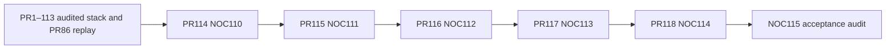

# NOC115 final acceptance assessment

**NO-GO — Blocked for operational release, production or live-equipment pilot.**
The integrated application is reproducibly installable for further **isolated,
disposable controlled acceptance**, subject to independently approved source/images
and nonproduction credentials. It is not an approved production release. High
operational/supply-chain gates A111-15/16 remain; passing CI cannot waive them.

Baseline: NOC114 draft PR118 at
`d46ace336bce97ce52dffdcc4be0abbc203e3f84`. Fresh GitHub reads confirm the PR is
open/draft, targeting NOC113; CI592/593 passed all9 jobs. The worktree was clean.
No AGENTS.md or contribution instructions were found at filesystem root, workspace,
repository root or tracked subdirectories. README, scripts and NOC110–114 reports
were reviewed. No existing PR is merged, closed or retargeted. NOC115 branches
directly from the specified commit and preserves unfinished ignored work.

## Exact source and feature evidence

- [Release manifest](release-manifest.json): all311 baseline commits and parents,
  exact tree, all118 reviewed PR tips/branches/bases, twenty feature mappings,
  Git blobs/SHA256/per-file source commits, executable wrappers,28 migrations and
  configuration names/types. No secret values are serialized.
- [Feature inventory](feature-manifest.md) and [catalog](feature-catalog.json):
  backend/UI/migration/test references and limitations. Source presence is separated
  from executed acceptance and actual vendor compatibility.
- [Fresh PR snapshot](pr-snapshot.json): all118 open draft PRs at audit start.
 117 tips are direct ancestors; PR86 is already represented by equivalent replay
 `ad61cde731a7707af44734a7261474af3409671e`, with equal patch and unchanged merge tree.
 Do not blindly re-merge/replay it. Main remains the old foundation, not this stack.

Review/integration order is the NOC110 manifest's foundation, PR1→85, explicit PR86
reconciliation, PR87→113, then PR114→115→116→117→118→this draft. This is provenance,
not permission to merge. The complete graph is [NOC110's graph](../../audits/NOC-110-dependency-graph.mmd)
plus the last five linear edges recorded in this manifest.



Reproduce from a full-history checkout:

```sh
python3 scripts/release/release_acceptance.py --candidate d46ace336bce97ce52dffdcc4be0abbc203e3f84 > /tmp/noc115-baseline.json
python3 scripts/release/release_acceptance.py --candidate HEAD > /tmp/noc115-current.json
```

The checked-in manifest intentionally pins the immutable application baseline.
The second command includes the new audit commit(s); final SHA/CI evidence is in
the NOC115 draft PR. A self-referencing manifest cannot contain its own commit SHA.

## Verified correction A115-01 — Medium, evidence integrity

`integration_manifest.audit(--candidate SHA)` previously checked that SHA's ancestry
but parsed migration/configuration files from the current checkout. A historical
candidate could therefore be described using unrelated uncommitted/newer files.
The correction reads the selected Git blobs and enumerates its migration tree.
Unpinned helper calls retain their documented working-tree behavior. A temporary
Git-repository regression changes both configuration and migration HEAD after a
commit and proves the historical inventory is unaffected. No migration or application
behavior is changed. Missing feature source is also a hard manifest failure.

## Evidence and decision

- [Installation evidence audit](installation-evidence.md), [pinned evidence](evidence.json).
- [Acceptance matrix](acceptance-matrix.md), [machine-readable matrix](acceptance-matrix.json).
- [Operator runbook](deployment-runbook.md), [safe configuration worksheet](../../../deploy/host/installation-review.example.json).

Existing NOC114 actual evidence:77 VM host assertions,26 fresh-failure assertions,
unsupported-OS rejection,68 browser tests and11 populated-upgrade/restore checkpoints.
Those are historical executions on the pinned baseline, not a substitute for final
NOC115 CI. New final-commit Actions reruns the actual Ubuntu systemd installer,
failure containers, migrations, browser suite, security and synthetic workflows;
exact results and resource measurements are recorded in the final draft PR ledger.

Local NOC115 focused execution used a disposable PostgreSQL16 database. Read-only
catalog inspection found370 foreign keys,102 unique constraints,172 primary keys,
44 checks,1 constraint trigger and514 indexes, with zero unvalidated constraints/invalid indexes.
Existing suites exercise transactional rollback, concurrent uniqueness, invalid
references and history retention. This does not establish production-data integrity.

Local validation before publication:813 unit tests passed,952 database-dependent
skips,2 warnings in20.69s;17 PostgreSQL release/cross-module cases passed,2 warnings
in27.43s. Counts overlap. The final focused release rerun and final-commit Actions
are recorded in the draft PR; skipped tests are not labeled passed. Shell syntax,
undefined-name/static compilation, supply-chain consistency and whitespace checks pass.

No required feature implementation was found missing in the twenty-module source
inventory. Several requested **live capabilities remain mocked, unsupported or
unverified** as explicitly listed. There is no published trusted release manifest,
signed application artifact pipeline, real provider delivery or reviewed offline-to-live
host activation configuration in this candidate.

## Outstanding release blockers

| ID | Severity/status | Required evidence |
|---|---|---|
| A111-15 | High / BLOCKED | Actual firmware/OID/read-only permissions; approved endpoint/TLS/egress; real provider contracts, mappings/consent, Grafana/WordPress/operator acceptance |
| A111-16 | High / BLOCKED | OS/native-image scan, Redis server license decision, trusted signed/published artifacts, deployed malware scanner, off-host complete key/file recovery, minimal-host boot/firewall/VPN/MFA |
| A111-12 | Medium / FAIL at15-second target | Native1000-device synthetic rounds exceed15seconds; choose measured intervals and run sustained history/concurrency sizing |
| A115-01 | Medium / corrected | Historical candidate inventories now read that Git tree; regression required in CI |

No new critical application defect was reproduced. This is not a deployed-host
penetration test or proof of vulnerability absence. Physical reboot/power-loss,
minimal ISO VM bootstrap and separate-host complete disaster recovery remain untested.
Their explicit procedures are in the runbook. Until high gates are resolved, the
assessment cannot be GO or merely CONDITIONAL for a live pilot.

No production deployment/data access, live equipment, production Powercode, real
SMS/email/public incidents, other repositories or automatic remediation were used.
AI Fiber Designer and MikroTik Management remain separate. RF self-healing remains
simulation-only. All live integrations stay disabled by default.
